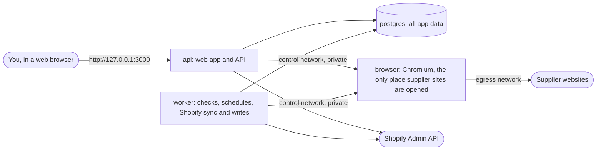
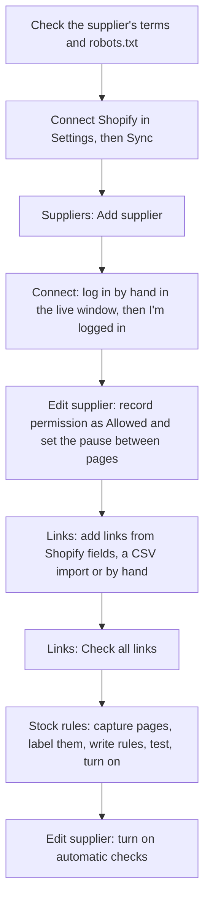
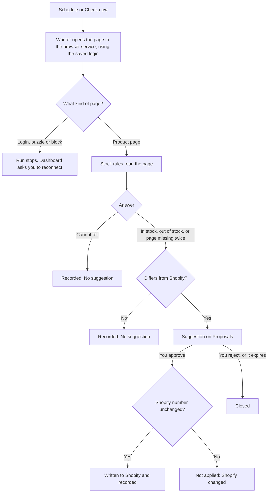

# Stock Monitor

Stock Monitor checks your suppliers' websites for stock and suggests stock changes for your Shopify store. **Nothing changes in Shopify until you approve that one change.**

It is built for one store owner who runs it alone. Everything is set up in the app's screens. You log in to each supplier yourself, in a live browser window inside the app. The app never asks for or stores a supplier password.

- [About the app](#about-the-app)
- [How it works](#how-it-works)
- [Main flows](#main-flows)
- [Run the app](#run-the-app)
- [Settings (.env)](#settings-env)
- [Backup and restore](#backup-and-restore)
- [Docker debugging](#docker-debugging)
- [Developer setup and tests](#developer-setup-and-tests)
- [Project layout](#project-layout)
- [Security notes](#security-notes)
- [More documentation](#more-documentation)

## About the app

Today, supplier stock is checked by hand, and an item that is out of stock at the supplier can still be sold in the shop. Stock Monitor does the checking for you:

1. **Suppliers.** You add a supplier and log in to its website through a live window in the app. The app keeps that login (encrypted) and checks that it still works.
2. **Links.** Each Shopify variant is linked to its product page at the supplier. Links come from Shopify product fields, from a CSV import of your Shopify export, or are added by hand.
3. **Stock rules.** You teach the app how one supplier's page shows stock, using saved copies of real pages. Example: "out of stock when the page says Sold out".
4. **Checks.** The app visits each link, on a schedule or when you press **Check now**, and records what it saw: in stock (with a quantity when shown), out of stock, page missing, or **Cannot tell**.
5. **Suggestions.** When the supplier's answer and Shopify's number disagree, a suggestion appears on **Proposals**. You approve, edit or reject each one. Only an approved suggestion is written to Shopify.

Rules the app always keeps:

- A login page, a puzzle (CAPTCHA), a block, a timeout or a changed page is **never** treated as out of stock. The answer is Cannot tell, and Cannot tell never leads to a suggestion.
- A missing page counts only after two checks at least 6 hours apart, on a link that worked before.
- If Shopify's number changed after a suggestion was made, nothing is written.
- No checks run until you record that you have the supplier's **permission** for automated checks.
- The app never solves puzzles, never hides that it is a program and never fakes being a person.

## How it works

Everything runs with Docker Compose on one machine (your Mac for the pilot, or a small server).



| Service    | What it does                                                                                                                                              |
| ---------- | --------------------------------------------------------------------------------------------------------------------------------------------------------- |
| `postgres` | PostgreSQL 17. Data lives in the `pgdata` Docker volume. Not reachable from outside Docker.                                                               |
| `migrate`  | Runs once on every start. Updates the database and sets up the restricted login role, then exits.                                                         |
| `api`      | The API and the web app, on `127.0.0.1:3000`.                                                                                                             |
| `worker`   | Background jobs: link checks, stock checks, schedules, Shopify sync, suggestions and approved writes.                                                     |
| `browser`  | A locked-down Chromium container with a virtual screen for the live login window. It has no database access and no encryption key, and publishes no port. |

## Main flows

### Setting up a supplier (once per supplier)



1. **Permission.** Read the supplier's terms. If they forbid automated access, ask the supplier first. This decision is yours, not the app's.
2. **Shopify.** In **Settings**, connect your store, pick the inventory location and press **Sync**. **Products** then lists your variants and SKUs.
3. **Supplier.** On **Suppliers**, add the supplier and press **Connect**. Log in as you normally would, then press **I'm logged in**. You have 15 minutes. The supplier then shows **Connected**.
4. **Permission and pause.** On the supplier's **Edit** page, set permission to **Allowed** and set the pause between pages (at least the crawl-delay in the supplier's `robots.txt`).
5. **Links.** Add links on **Links**. Check them once with **Check all links**.
6. **Stock rules.** On **Stock rules**, capture at least one in-stock page and one out-of-stock page, label them, write the rules, and turn the rules on when every example passes.
7. **Automatic checks.** On the supplier's **Edit** page, turn on automatic checks (daily, 07:00 to 22:00 by default).

The full walk-through, with worked examples of stock rules, is in [docs/pilot-flow.md](docs/pilot-flow.md).

### A stock check, from page to Shopify



| Supplier said                            | Shopify shows | Suggestion                                                 |
| ---------------------------------------- | ------------- | ---------------------------------------------------------- |
| Out of stock                             | more than 0   | Set to 0                                                   |
| Page missing (two checks, 6 hours apart) | more than 0   | Set to 0                                                   |
| In stock                                 | 0             | Set to the back-in-stock quantity (5 by default, editable) |
| Cannot tell                              | anything      | Nothing, ever                                              |

Suggestions stay open for 24 hours by default (set in **Settings**). They are approved one at a time. There is no approve-all.

### Day to day

1. **Dashboard:** read **Needs attention**. It shows a supplier to reconnect, stock rules to review after a page changed, or a suggestion that needs a look.
2. **Proposals:** approve or reject suggestions.
3. **Suppliers:** check that each status is **Connected** and the last run looks normal.

## Run the app

### What you need

- Docker Desktop (Mac or Windows) or Docker Engine with Compose (Linux).
- At least 5 GB of free disk space. The browser image alone is about 2.6 GB.
- `git` and `openssl`.

### First run

```bash
git clone https://github.com/Deepak0844/stock-monitor.git
cd stock-monitor
cp .env.example .env
```

Open `.env` and fill in the four secrets. Each one has the command that makes it in the comment above it:

```bash
openssl rand -hex 24      # POSTGRES_PASSWORD, APP_DB_PASSWORD, BROWSER_CONTROL_TOKEN (run it once for each)
openssl rand -base64 32   # APP_ENCRYPTION_KEY
```

For a local run on plain `http`, also set `COOKIE_SECURE=false`. Then start everything and create your sign-in:

```bash
docker compose up -d --build
docker compose run --rm api node --import tsx apps/api/src/cli/create-owner.ts
```

Open http://127.0.0.1:3000 and sign in.

The first build takes several minutes. `docker compose ps` must then show `api` and `browser` as healthy, and `migrate` as exited with code 0.

### Updating

```bash
git pull
docker compose up -d --build
```

Database changes run by themselves before the API and worker start. If Compose stops with `Set ... in .env`, add that setting to `.env` (see `.env.example`) and run it again.

### Stopping and starting

```bash
docker compose stop        # stop everything, keep all data
docker compose start       # start again
docker compose down        # remove the containers, keep all data
```

> **Never run `docker compose down -v`.** The `-v` deletes the `pgdata` volume, which holds every supplier, link, rule, check and suggestion.

Running on a server instead of your own computer needs HTTPS and some server hardening first. See [docs/deployment.md](docs/deployment.md).

## Settings (.env)

`.env` holds your real secrets. Never commit it and never share it. After changing it, run `docker compose up -d` (add `--build` after a `git pull`).

| Setting                           | Required | What it does                                                                                                                                                                                   |
| --------------------------------- | -------- | ---------------------------------------------------------------------------------------------------------------------------------------------------------------------------------------------- |
| `POSTGRES_PASSWORD`               | yes      | Database owner password. Used only by PostgreSQL and the `migrate` step. Letters and digits only.                                                                                              |
| `APP_DB_PASSWORD`                 | yes      | Password of the restricted role the API and worker use. Letters and digits only.                                                                                                               |
| `APP_ENCRYPTION_KEY`              | yes      | Encrypts saved supplier logins and the Shopify token. 32 random bytes, base64. **Keep a copy in a password manager.**                                                                          |
| `BROWSER_CONTROL_TOKEN`           | yes      | Shared secret between the API, the worker and the browser service. At least 32 characters.                                                                                                     |
| `COOKIE_SECURE`                   | no       | `true` (default) behind HTTPS. `false` only for a local plain-http run.                                                                                                                        |
| `TRUST_PROXY`                     | no       | `true` only behind a reverse proxy that overwrites `X-Forwarded-For`. Otherwise `false`.                                                                                                       |
| `LOG_LEVEL`                       | no       | `info` (default). Use `debug` while chasing a problem.                                                                                                                                         |
| `APP_ORIGIN`                      | no       | The address you open the app at, for example `https://stock.example.com`. The live login window only works from this address. Blank means `http://localhost:3000` and `http://127.0.0.1:3000`. |
| `BROWSER_TIMEZONE`                | no       | Your timezone, for example `Asia/Kolkata`. Used by the browser and by the quiet hours of automatic checks. Blank means UTC.                                                                    |
| `BROWSER_LANGUAGE`                | no       | Your browser language, for example `en-IN`. Blank keeps the browser's default.                                                                                                                 |
| `LOGIN_WINDOW_MODE`               | no       | `controlled` (default) or `plain`. Try `plain` if a supplier's puzzle rejects a login you solved correctly.                                                                                    |
| `VERIFY_MODE`                     | no       | `headless` (default) or `profile`. `profile` runs checks from a persistent, ordinary-looking Chromium.                                                                                         |
| `LOGIN_PROFILE`                   | no       | `fresh` (default) or `persistent`. `persistent` keeps one login-window profile per supplier site while the container runs. Needs `LOGIN_WINDOW_MODE=plain`.                                    |
| `SHOPIFY_SUPPLIER_NAME_METAFIELD` | no       | The Shopify product field with the supplier's name. Default `custom.supplier_name`.                                                                                                            |
| `SHOPIFY_SPU_METAFIELD`           | no       | The Shopify product field with the supplier's page address. Default `custom.spu`.                                                                                                              |

## Backup and restore

Back up two things:

1. **`.env`**, above all `APP_ENCRYPTION_KEY`. Keep a copy in a password manager. Without the key, saved supplier logins and the Shopify token cannot be read. You would have to reconnect every supplier and Shopify.
2. **The database.** Every supplier, link, stock rule, check, suggestion and audit record.

Keep backups **outside the repo folder**. The repository is public, and a dump holds private data.

### Back up the database

With the app running:

```bash
mkdir -p ~/stock-monitor-backups
docker compose exec -T postgres pg_dump -U stock_owner -d stock_monitor -Fc \
  > ~/stock-monitor-backups/stock-monitor-$(date +%F).dump
```

The file must be larger than a few kilobytes. Copy it somewhere off this machine, for example cloud storage.

### Restore on the same machine

This replaces the current data with the backup.

```bash
docker compose stop api worker
docker compose exec -T postgres pg_restore -U stock_owner -d stock_monitor \
  --clean --if-exists --single-transaction \
  < ~/stock-monitor-backups/stock-monitor-YYYY-MM-DD.dump
docker compose up -d
```

`--single-transaction` means a failed restore changes nothing.

### Restore on a new machine

1. Clone the repo and put your saved `.env` in the folder. It must hold the **same `APP_ENCRYPTION_KEY`**.
2. Run `docker compose up -d --build`. This creates an empty, up-to-date database.
3. Run the three commands in "Restore on the same machine".
4. Sign in with your usual owner login. It is in the backup.

These steps were tested on an empty database and on one that already held data.

## Docker debugging

Start here every time:

```bash
docker compose ps
```

Every service must be `running`, `api` and `browser` must be `healthy`, and `migrate` must be `exited (0)`.

| Problem                                             | Do this                                                                                                                                                             |
| --------------------------------------------------- | ------------------------------------------------------------------------------------------------------------------------------------------------------------------- |
| Compose stops with `Set ... in .env`                | That setting is missing. Copy it from `.env.example` and fill it in.                                                                                                |
| `migrate` exited with an error                      | `docker compose logs migrate`. Usually a wrong `POSTGRES_PASSWORD`. That password is fixed when the database is first created, so it must stay the same afterwards. |
| App does not open at http://127.0.0.1:3000          | `docker compose logs --tail=100 api`. Check `curl http://127.0.0.1:3000/health` returns `{"status":"ok"}`. Check nothing else uses port 3000: `lsof -i :3000`.      |
| You cannot stay signed in on a local http run       | Set `COOKIE_SECURE=false` in `.env`, then `docker compose up -d`.                                                                                                   |
| Live login window does not open                     | `docker compose ps`: is `browser` healthy? Only one login window can be open at a time. `docker compose logs --tail=100 browser`.                                   |
| Live window refuses to connect from another address | Set `APP_ORIGIN` to the exact address you open the app at.                                                                                                          |
| Checks are stuck or every check times out           | `docker compose logs --tail=200 worker browser`, then `docker compose restart browser worker`. Runs cut off by a restart are closed by themselves on start.         |
| A change in `.env` did nothing                      | Run `docker compose up -d`. `restart` does not read `.env` again.                                                                                                   |
| Odd behaviour after a `git pull`                    | You probably skipped the rebuild: `docker compose up -d --build`.                                                                                                   |
| Out of disk space                                   | `docker system df`, then `docker image prune` and `docker builder prune`. Never prune volumes.                                                                      |
| A build seems broken by an old cache                | `docker compose build --no-cache`, then `docker compose up -d`.                                                                                                     |

Useful commands:

```bash
docker compose logs -f api worker                    # follow the logs live (Ctrl+C to stop)
docker compose logs --since=30m worker               # the last 30 minutes of one service
docker compose exec api sh                           # a shell inside the api container
docker compose exec postgres psql -U stock_owner -d stock_monitor   # a database shell
docker compose restart worker                        # restart one service
docker compose up -d --force-recreate browser        # recreate one service from scratch
```

More detail in the logs: set `LOG_LEVEL=debug` in `.env`, run `docker compose up -d`, reproduce the problem, then set it back to `info`.

The `browser` container's filesystem is read-only. Restart it instead of changing anything inside it.

## Developer setup and tests

You need Node.js 22 or newer, npm 10 or newer, and Docker running. Database tests start their own throwaway PostgreSQL with Testcontainers. They never touch your running stack or your `.env`.

This repo uses **npm workspaces**. Do not use pnpm or yarn.

```bash
npm ci
npm run check            # typecheck, lint, unit tests and database tests (what CI's check job runs)
```

| Command                    | What it runs                                                                                                                  |
| -------------------------- | ----------------------------------------------------------------------------------------------------------------------------- |
| `npm run typecheck`        | TypeScript across the repo.                                                                                                   |
| `npm run lint`             | ESLint.                                                                                                                       |
| `npm run test:unit`        | Unit tests (Vitest).                                                                                                          |
| `npm run test:integration` | Tests against a real PostgreSQL in Docker (`*.int.test.ts`).                                                                  |
| `npm run test:browser`     | Browser service tests with real Chromium (`*.browser.test.ts`). Run `npx playwright install --with-deps chromium` once first. |
| `npm run test:container`   | Builds the images and checks the container lockdown and Compose setup (`*.docker.test.ts`).                                   |
| `npm run test:e2e`         | Builds the app and runs Playwright journeys against a fake supplier site and a fake Shopify.                                  |
| `npm run db:generate`      | Makes a new migration after a change to `packages/db/src/schema.ts`.                                                          |

Automated tests never visit a real supplier or a real Shopify store.

To work on the screens with live reload, keep the Docker stack running (it serves the API on port 3000), then run `npm run dev -w @stock-monitor/web`. Vite sends `/api` calls to port 3000.

Git: `master` holds releases, and `develop` is where work comes together. Work on a short `feature/…`, `fix/…`, `docs/…` or `chore/…` branch cut from `develop`, open a pull request into `develop`, and merge once CI is green.

## Project layout

| Folder                                        | What is in it                                                                                      |
| --------------------------------------------- | -------------------------------------------------------------------------------------------------- |
| `apps/api`                                    | Fastify API. It also serves the built web app.                                                     |
| `apps/web`                                    | React web app (Vite, Tailwind).                                                                    |
| `apps/worker`                                 | pg-boss job worker: checks, schedules, Shopify sync and writes.                                    |
| `services/browser`                            | The isolated browser service: Chromium, the live login window, page capture and the address guard. |
| `packages/db`                                 | Database schema, migrations (Drizzle) and data access.                                             |
| `packages/shopify`                            | Shopify Admin API client. Stock writes live in one file only: `inventory-write.ts`.                |
| `packages/supplier-session`                   | Supplier records, address checks, page classification and sealed (encrypted) logins.               |
| `packages/mapping`                            | Links between Shopify variants and supplier pages, CSV import and link status rules.               |
| `packages/extraction`                         | Stock rules: checking, running and testing them against saved pages.                               |
| `packages/scheduling`                         | Automatic check timing, quiet hours, retries and backoff.                                          |
| `packages/proposals`                          | Suggestion rules: when to suggest, expiry and conflicts.                                           |
| `packages/browser-client`                     | How the API and worker talk to the browser service.                                                |
| `packages/queue`, `audit`, `crypto`, `shared` | The job queue, audit log, encryption and shared types.                                             |
| `e2e`                                         | Playwright journeys, with a fake supplier site and a fake Shopify.                                 |
| `docs`                                        | Deployment guide, pilot walk-through and project status.                                           |

## Security notes

- **Supplier sites are opened only in the `browser` container.** It is on its own networks, with no database access, no encryption key and no published port. Every capability is dropped except the one Chromium's sandbox needs, the filesystem is read-only, and it has memory, CPU and process limits.
- **No private addresses.** A proxy inside the browser container refuses private, loopback and cloud-metadata addresses, and checks every redirect.
- **Supplier passwords are never stored.** You log in by hand. The saved login is encrypted with AES-256-GCM using `APP_ENCRYPTION_KEY`, which is kept outside the database. Saved logins never appear in logs or in the web app.
- **The live login window has several locks.** You must be signed in to the app and on an allowed address, and each window needs a one-time token. The window's VNC screen has its own random password.
- **The audit log cannot be edited.** The API and worker use a database role that can add audit events but cannot change or delete them.
- **The repository is public.** Never commit `.env`, database dumps, supplier names, supplier addresses or screenshots of supplier pages.
- Before running on a server, follow "Server hardening" in [docs/deployment.md](docs/deployment.md): HTTPS, firewall, SSH keys only and automatic updates.

## More documentation

- [docs/pilot-flow.md](docs/pilot-flow.md): the full flow, from an empty app to stock suggestions, with worked stock rule examples.
- [docs/deployment.md](docs/deployment.md): running on a server, the browser service in depth, statuses, Shopify permissions and server hardening.
- [docs/status.md](docs/status.md): where the app stands, and the problems we hit with how each was fixed.
