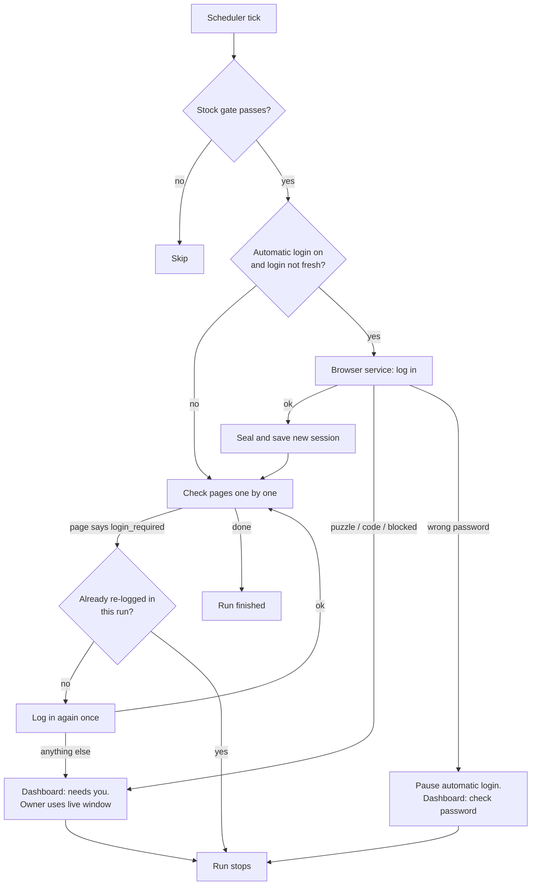

# Automatic supplier login, with optional stealth

Date: 2026-11-17. Size: project (full design).

## Why

Today the owner logs in to every supplier by hand in the live window, and the app reuses the saved cookies. That breaks in
two ways:

1. **Short sessions.** Some suppliers end a session after about an hour of idle time (a server-side session, confirmed
   2026-11-14). A daily run always finds the login expired, so the owner has to log in by hand before every run.
2. **Bot checks.** Some suppliers detect that the browser is automated and show a puzzle or refuse the login.

The owner wants the daily check to run by itself: the app logs in when it needs to, and only asks the owner when a supplier
shows a puzzle or asks for a code.

**This reverses two earlier decisions**, by the owner's choice on 2026-11-17:

- "Logging in automatically with a stored password was decided against" (`docs/status.md`,
  `2026-11-13-session-refresh-design.md`). Now: allowed, per supplier, when the owner switches it on.
- "No spoofing, stealth or captcha solving, ever" (`docs/status.md`, README). Now: stealth is allowed per supplier.
  **Puzzle solving stays forbidden.**

The docs that state the old rules must be updated in the same change (see "Docs to update").

## Goals

1. Per supplier, the owner can save a username and password and switch on **Automatic login**.
2. Before a run, the app logs in by itself if the saved login is not fresh. A 1-hour session limit stops mattering, because
   the login happens minutes before the checks.
3. If the login expires in the middle of a run, the app logs in again **once** and carries on.
4. When the supplier shows a puzzle or asks for a code, the app stops and tells the owner, who finishes the login in the
   existing live window (and types the code there). The next run logs in automatically again.
5. Per supplier, the owner can switch on **Stealth**: the browser hides the usual signs of automation for every visit to
   that supplier (login and checks).

## Non-goals

- **Solving puzzles.** No solver code, no puzzle-solving services, no clicking puzzle widgets.
- **Reading codes automatically** (email inbox, SMS, authenticator secrets). The owner types codes by hand. A later change
  could add authenticator (TOTP) codes.
- **Keep-alive visits** to stop a session going idle. Dropped (see Approaches).
- **A login recorder.** Unusual login pages get a small per-supplier override instead (see "Finding the login form").
- **New notification channels** (email, push). The existing dashboard notice is used.

## Anti-goals (a failure even if it works)

- A password, or anything derived from it, in a log, the audit log, an API response, the browser service's disk, or an error
  message.
- The app locking the owner's supplier account by retrying a wrong password.
- The app retrying after a puzzle, block or code request. One attempt, then it hands over to the owner.
- Automatic login or stealth running for a supplier the owner has **not** marked as allowing automatic checks.
- A login from the app overwriting a login the owner made in the live window at the same moment.
- Visiting a supplier during its quiet hours.

## Constraints (from the existing system)

- **Sealing.** Sessions are sealed with AES-256-GCM (`packages/crypto`, `packages/supplier-session/src/seal.ts`). The browser
  service never holds the key. The worker unseals and hands plain state to the browser service only for the moment of a
  check. Credentials follow the same rule.
- **Browser service isolation** (`docs/deployment.md`, "The browser service"). Its own container, no database, no key,
  read-only filesystem, a guard proxy, Chromium sandbox on with Playwright's seccomp profile. Nothing in this design
  loosens that. Any stealth tool must run under the same sandbox and seccomp profile.
- **Persistent profiles.** `LOGIN_PROFILE=persistent` keeps one browser profile per site, so the supplier sees a returning
  browser. Automatic login uses that same profile. A returning browser gets fewer puzzles.
- **One live window at a time** (`login_sessions_one_open`). Automatic login does not use the live window or the shared
  screen slot. It runs in its own browser context, like a check.
- **Runs**: at most two suppliers at once (`MAX_RUNS_AT_ONCE`), pages one at a time per supplier, quiet hours respected.
- **Permission gate.** `suppliers.automation_permission` already records whether the owner says a supplier allows
  automatic checks. Link checks need `granted`.
- **Classifier.** `classifyPage` (`packages/supplier-session/src/classify.ts`) already tells `ok`, `login_required`,
  `captcha`, `blocked`, `unreachable` and `unknown` apart.

## Approaches

| Approach | Trade-off | Verdict |
| --- | --- | --- |
| **A. Log in before the run, hand over to the owner when stuck** | Stores passwords (sealed). One login per run looks like a person starting their day. Puzzles and codes still need the owner | **Picked by the owner**, with stealth per supplier |
| B. Keep-alive visits every ~15 minutes | No stored passwords. About 96 visits a day, day and night, which looks more like a bot and raises the terms risk. May not count as activity on an idle-timeout server. Once a session dies, the owner still has to log in | Dropped |
| C. Record the owner's login once and replay it | Handles odd multi-step pages. A recorder UI to build, and replays break when the page changes | Dropped. A's selector override covers most odd pages |

Stealth was not a separate approach. It is a per-supplier switch on top of A, because a controlled browser tells every
page `navigator.webdriver = true` (seen before, see `docs/status.md`), and some suppliers reject the login for that alone.

## The design

### How a run works now, and what changes



The new parts are the "Automatic login" box and the "log in again once" branch. Everything else exists today.

### 1. Data model (`packages/db`)

New table `supplier_credentials`. It is kept out of `suppliers` so that no ordinary supplier query can ever load it, the
same way `supplier_sessions` is kept apart.

| Column | Type | Notes |
| --- | --- | --- |
| `supplier_id` | uuid, primary key | references `suppliers.id`, `on delete cascade` |
| `ciphertext`, `iv`, `tag`, `key_id` | text | the sealed JSON `{ "username": "...", "password": "...", "account": "..." }` (`account` optional: an account or customer number some trade suppliers ask for), using `encrypt` from `packages/crypto` |
| `saved_at` | timestamptz | shown on screen as "Password saved 17 Nov" |

Nothing about the username or password is stored in plain text, not even a hint.

New columns on `suppliers`:

| Column | Type | Default | Meaning |
| --- | --- | --- | --- |
| `auto_login` | boolean | false | the owner's switch |
| `stealth` | boolean | false | the owner's switch |
| `login_selectors` | jsonb, nullable | null | optional override: `{ "open": "css", "username": "css", "password": "css", "submit": "css" }` |
| `auto_login_failures` | integer | 0 | failed automatic logins in a row |
| `auto_login_paused_reason` | text, nullable | null | `wrong_password`, `account_locked` or `too_many_failures`; null means not paused |
| `last_auto_login_at` | timestamptz, nullable | null | |
| `last_auto_login_result` | text, nullable | null | one of the result codes below |

Database checks:

- `auto_login` can be true only when `automation_permission = 'granted'` and a credentials row exists. The API enforces the
  row part; the column check enforces permission.
- `stealth` can be true only when `automation_permission = 'granted'`.
- `auto_login_paused_reason` is null or one of the two codes.

If the owner later changes permission away from `granted`, the API switches `auto_login` and `stealth` off in the same
transaction.

`notifications.reason` gains four codes: `code_required`, `wrong_password`, `account_locked` and `form_not_found` (update the
`notifications_reason` check and the `NotificationReason` type). They use the existing `supplier_needs_reconnect` kind, so
the one-open-notice-per-supplier rule still holds.

### 2. Browser service (`services/browser`)

New endpoint `POST /login`, behind the same `BROWSER_CONTROL_TOKEN` check as `/verify`, `/check-page` and `/capture`.

Request:

```ts
type LoginRequest = {
  loginUrl: string;        // supplier.loginUrl ?? supplier.websiteUrl
  checkUrl: string;        // a page that needs a login, to confirm success (supplier.websiteUrl, or the first mapping's URL)
  username: string;
  password: string;
  stealth: boolean;
  account?: string;        // only when the owner saved one
  selectors?: { open?: string; account?: string; username?: string; password?: string; submit?: string };
};
```

Response:

```ts
type LoginOutcome = {
  result: "ok" | "captcha" | "code_required" | "wrong_password" | "account_locked" | "blocked" | "form_not_found" | "unreachable" | "unknown";
  state?: SessionState;    // only when result is "ok"
};
```

Steps:

1. Open the supplier's persistent profile for that site (`profile-store.ts`), headed on the private screen, like
   `VERIFY_MODE=profile`. The guard proxy is in front, as for every visit.
2. Go to `loginUrl`. If the classifier already says `ok` (still logged in), skip to step 6.
3. Run the **step loop** (see "Finding the login form"): open the login if it is behind a button or modal, fill what each
   step shows, move to the next step. Type with `pressSequentially` and a small random delay between keys (40 to 120 ms).
   If the loop finds no form, return `form_not_found`.
4. After the password is submitted, handle a "Stay signed in?" prompt if one appears (click "Yes" / "Stay signed in").
5. Wait for the page to settle (navigation, or 12 s, the same settle time profile checks use), then decide the result in
   this order:
   - a visible puzzle widget (the existing `CHALLENGE_WIDGET` list) → `captcha`
   - a visible one-time-code field (`autocomplete="one-time-code"`, or an input whose label or placeholder says code,
     verification or OTP), or visible text asking to approve on a phone or check email → `code_required`
   - visible text saying the account is locked or there were too many attempts → `account_locked`
   - still on the login page with a visible password field → `wrong_password`
   - otherwise use the classifier on the page.
6. Confirm by loading `checkUrl` and classifying it. Only `ok` there counts as `ok`.
7. On `ok`, read the session state the same way checks do today (`withFreshState`), and return it.

The browser service **never writes the password anywhere**. It lives in the request body in memory and is dropped when
the request ends. Its request logging must leave out the body of `/login`. Add a test that the password does not appear
in anything it logs.

**One attempt per request.** The service does not retry. Retries are the worker's decision.

#### Finding the login form

Login pages come in many shapes: a plain form, a form in a modal behind a "Sign in" button, a form inside an iframe, or
several steps (email, then Next, then a choice screen, then password). One loop handles all of them.

**Fields, searched in every frame of the page** (main page and iframes), visible elements only:

- Password field: the first visible `input[type=password]`.
- Username field: the last visible `input` before the password field (or, on a username-only step, the first visible one)
  whose type is `email`, `text` or `tel`, or that has `autocomplete="username"`.
- Next button: the form's visible `button[type=submit]` or `input[type=submit]`, else a visible button or link whose text
  is "Next", "Continue", "Sign in", "Log in" or "Login" (case-insensitive). If none, press Enter in the last filled field.

**The step loop**, at most 5 steps:

1. Nothing to fill (no username or password field visible): this is the "open the login" step. Click the first visible
   link or button whose text is "Sign in", "Log in", "Login" or "My account", then wait up to 15 s for a field. Allowed
   once.
2. An account field that is empty and an account number is saved: type it. An account field is a visible text input
   whose label, name, id or placeholder says "account", "customer number", "customer no" or "account no" (case-insensitive),
   or the `account` override. It is checked before the username rule, so it is never mistaken for the username box.
   A username field that is empty: type the username. A password field: type the password. Tick a visible "Remember me"
   / "Keep me signed in" checkbox if there is one.
3. A choice screen with a visible "Use password" / "Sign in with password" button and no field: click it.
4. Click the next button, wait up to 15 s for the page or the visible fields to change.
5. After each step, stop the loop at once on a visible puzzle (`captcha`) or code field (`code_required`).
6. The loop ends when the password has been submitted. Five steps without that, or a step where nothing changed,
   returns `form_not_found`.

**Cookie banner in the way.** If a click fails because another element covers the target, click a visible "Accept",
"Accept all", "Allow all" or "Agree" button once, then retry that click. Only once per login.

**Overrides.** If `selectors` are given, they replace the matching automatic rule: `open` (the button that opens the
login), `username`, `password`, `submit`. An override that is not found on the page returns `form_not_found`. Do not fall
back to guessing.

Hidden fields are ignored, as in the classifier. Once the password has been submitted, the loop never types the username
again (a later text box could be a security question).

#### Every login case, and what happens

"Owner" means the app stops, raises the dashboard notice, and the owner finishes in the live window. It never retries.

**Page shapes**

| Case | Handled by | Result |
| --- | --- | --- |
| Plain username + password form | step loop | logs in |
| Form in a modal behind "Sign in" | "open the login" step, or `open` override | logs in |
| Form inside an iframe (same or other site) | all-frames search | logs in |
| Several steps: email → Next → password | step loop | logs in |
| Choice screen: "Use password" / "Send me a code" | clicks "Use password" | logs in |
| Login on another site (SSO page, e.g. `accounts.…`) | browser follows the redirect | logs in |
| Form inside web components (open shadow DOM) | Playwright locators pierce it | logs in |
| Password-only or PIN page (no username box) | step loop fills the password only | logs in |
| Odd page the rules misread | the four overrides | logs in |
| Account or customer number box | saved `account` value, account rule or `account` override | logs in |
| An account box the page needs, but no account number saved | nothing to type there | `form_not_found`, owner |
| Branch or region picker (a drop-down) | **not covered** | `form_not_found`, owner |
| "Sign in with Google / Microsoft" only | **not supported** (would need that account's password) | `form_not_found`, owner |
| Magic link sent by email, no password | **not supported** | `form_not_found`, owner |
| On-screen PIN pad, random keys, closed shadow DOM | **not supported** | `form_not_found`, owner |
| Terms tick box that must be ticked before the button works | **not covered** | `form_not_found`, owner |

**Things in the way**

| Case | Handled by | Result |
| --- | --- | --- |
| Cookie banner over the form | one click on "Accept" / "Accept all" / "Allow all" / "Agree" | carries on |
| Newsletter or promo popup over the form | one click on "No thanks" / "Close" / "×" (same one-click rule) | carries on |
| "Checking your browser" page before the login (Cloudflare and similar) | waits up to 15 s for it to pass by itself | carries on, else `blocked`, owner |
| Visible puzzle | stop | `captcha`, owner |
| Invisible bot score (reCAPTCHA v3, managed Turnstile) | nothing to click; stealth may help | logs in, or `blocked`, owner |

**Codes and second checks**

| Case | Result |
| --- | --- |
| Email or SMS code | `code_required`, owner types it in the live window |
| Authenticator app code | `code_required`, owner |
| "Approve on your phone" page (push) | `code_required`, owner (detected by visible text: "approve", "check your phone", "sent a notification") |
| "New device, check your email" link | `code_required`, owner (same text rule plus "verify") |

**After the password**

| Case | Result |
| --- | --- |
| Logged in | `ok` |
| "Stay signed in?" prompt | clicks "Yes", then `ok` |
| Wrong password | `wrong_password`, automatic login paused |
| Account locked, or "too many attempts" | `account_locked`, **automatic login paused at once** (like a wrong password: retrying would make it worse) |
| Password expired, must set a new one | `unknown`, owner |
| New terms to accept | `unknown`, owner |
| Account or branch chooser after login | `unknown`, owner |
| Site down, maintenance, rate limited (429) | `unreachable`, the run's normal retry delays |
| Already logged in when the page opens | `ok`, nothing typed |

**Sessions**

| Case | Handled by |
| --- | --- |
| Session kept in cookies | read from the profile's cookie file, as checks do today |
| Session kept in the page's storage (a token in `localStorage`, common on modern sites) | the persistent profile keeps it on disk between visits. The login also reads `context.storageState()` while the debugging channel is open, so the saved state has the page storage in `origins`, not just cookies |
| Short token that the site's own page refreshes (a "refresh token") | works by itself: the persistent profile keeps the refresh token, and the site's script renews the short one on each visit |
| Supplier allows only one session per account | **conflict**: the app's login logs the owner out of their own browser, and the other way round. The owner should give the app its own supplier user if the supplier allows it |

#### Stealth

When `stealth` is true, the browser for that visit (login **and** checks for that supplier) is launched through
**Patchright**, a drop-in replacement for Playwright's Chromium driver that removes the usual automation signs
(`navigator.webdriver`, the `Runtime.enable` leak, automation switches). It is used only for suppliers with the switch on.
Everything else keeps plain Playwright.

Stealth also means:

- headed, on the private screen, never headless;
- the persistent per-site profile (already the default);
- the real `BROWSER_TIMEZONE` and `BROWSER_LANGUAGE`, which must be set (the service refuses a stealth visit with a plain
  message if they are blank, because a UTC browser with no language undoes the point);
- no faked user agent, screen size or fonts. Patchright's changes only.

The `/check-page` and `/capture` requests get an optional `stealth: boolean` field so checks use the same browser as the
login. A login from a hidden browser followed by checks from an obvious one would look inconsistent to the supplier.

Builder's call, with a fallback: if Patchright does not run under the existing sandbox and seccomp profile, stop and come
back. Do not turn the sandbox off to make it work.

### 3. Browser client (`packages/browser-client`)

Add `login(request): Promise<{ ok: true; outcome: LoginOutcome } | { ok: false; reason: "unavailable" }>`, with the
`pageTimeoutMs` timeout (logins can be slow). Pass `stealth` through on `checkPage` and `capture`.

### 4. Worker (`apps/worker`)

New module `auto-login.ts` with one function:

```ts
ensureLoggedIn(deps, supplier, { force }): Promise<"ready" | "skipped" | StopReason>
```

- **Skipped** when `auto_login` is false, or `auto_login_paused_reason` is set. The run then carries on exactly as today.
- **Fresh enough** (no login needed): when `force` is false and the session's `last_verified_at` is less than
  `AUTO_LOGIN_FRESH_MINUTES` (10, a constant) old. Return `ready`.
- Otherwise unseal the credentials, call `browser.login`, and act on the result:

| Result | What the worker does | Counter |
| --- | --- | --- |
| `ok` | Seal and save the new session (replace it, see below). Set `last_verified_at`. Return `ready`. | reset to 0 |
| `captcha`, `code_required`, `blocked` | `raiseNeedsAttention` (code → "the supplier asked for a code, log in in the live window"). Return the stop reason. | +1 |
| `wrong_password` | Set `auto_login_paused_reason = 'wrong_password'` and notify "the saved password was refused". Return `login_required`. **Never retried.** | +1 |
| `account_locked` | Set `auto_login_paused_reason = 'account_locked'` and notify "the supplier says the account is locked". Return `blocked`. **Never retried.** | +1 |
| `form_not_found`, `unknown` | Notify "automatic login could not find the login form", with a link to the selector override. Return `login_required`. | +1 |
| `unreachable` | Return `unreachable`, so the existing retry delays apply (15 min, 1 h, 4 h). | unchanged |

When the counter reaches **2**, set `auto_login_paused_reason = 'too_many_failures'`. Paused automatic login is resumed by
the owner: a successful live-window login, saving the password again, or pressing "Resume" on the supplier page. All three
reset the counter and the pause.

Every attempt records `supplier.auto_login` in the audit log with `{ supplierId, result, stealth }` only, and sets
`last_auto_login_at` and `last_auto_login_result`.

**Saving the session.** A fresh login replaces the stored session; it does not merge with the old one, because old
cookies from a dead session are worthless. Use the same compare-and-swap as `saveRefreshedSession`: read the session row's
`state_iv` before the login, and save only if it is unchanged. If the owner logged in through the live window while the
automatic login ran, keep the owner's login and drop the app's.

**Callers:**

- `extraction-check.ts` and `mapping-link-check.ts`: call `ensureLoggedIn(force: false)` once at the start of a run, after
  the gate. If it returns a stop reason, the run stops with that reason, as it does today for a failed visit.
- In the same two files, when a page comes back `login_required` and auto-login is on: call `ensureLoggedIn(force: true)`
  once per run, then retry that page once. A second `login_required` in the same run stops the run as today.
  `captcha` and `blocked` on a page still stop at once, with no login attempt.
- `supplier-verify.ts` (the "Check login" button and the early check): unchanged for suppliers without auto-login.

**Early check** (`scheduling-tick.ts`): skip it for suppliers with `auto_login` on and not paused. The run logs in by
itself, and a login 2 hours early would not survive a 1-hour session anyway.

**New job** `supplier.session.login` `{ supplierId }`, for the "Test login now" button. It runs `ensureLoggedIn(force: true)`
and nothing else. It respects quiet hours and refuses while the supplier has a run going.

### 5. API (`apps/api`)

All routes need a signed-in owner and the existing CSRF and origin checks.

- `PUT /suppliers/:id/credentials` `{ username, password, account? }`: seals and saves. Username and password required, 1 to 200 characters; account optional, 1 to 200.
  Responds `{ savedAt }`, never the values. Resets the counter and the pause.
- `DELETE /suppliers/:id/credentials`: deletes the row and switches `auto_login` off.
- `PATCH /suppliers/:id` accepts `autoLogin`, `stealth` and `loginSelectors`. `autoLogin: true` is refused (409, plain
  message) without saved credentials or without `granted` permission.
- `POST /suppliers/:id/auto-login/test`: queues `supplier.session.login`. Rate limited to one per minute per supplier.
- `POST /suppliers/:id/auto-login/resume`: clears the pause and the counter.
- The supplier response gains `autoLogin`, `stealth`, `credentialsSavedAt`, `lastAutoLoginAt`, `lastAutoLoginResult`,
  `autoLoginPausedReason`. **There is no route that returns a username or password.**
- Add `password` and `username` to the logger's redact paths for these routes.

### 6. Screen (`apps/web`, supplier page)

A new card, "Automatic login", below the existing session card. A rough sketch, not the final look (the UI skills apply
when it is built):

```
Automatic login                                           [ On  ]
  Logs in for you before each check, using a password you save here.
  Needs "Allows automatic checks" to be Yes.

  Account number (optional) [ ••••••  ]
  Username  [ ••••••••••••          ]
  Password  [ ••••••••••••          ]   Password saved 17 Nov
            [ Save ]  [ Remove ]

  Hide automation (stealth)                              [ Off ]
  Only for suppliers that refuse the normal login.

  Last automatic login: 17 Nov 06:58, logged in
  [ Test login now ]

  > Login page fields (advanced)
      Open login button [ a.sign-in ]
      Account field   [ #custno     ]
      Username field  [ #email      ]
      Password field  [ #password   ]
      Login button    [ button.go   ]
```

- After saving, both fields show as empty with "Password saved <date>". Saved values are never sent back to the page.
- When paused, the card shows why ("The supplier refused the saved password" / "Two automatic logins failed in a row") and
  a **Resume** button.
- When permission is not `granted`, the switches are disabled with one line saying why.

### 6b. Logged-in marker (added 2026-11-17, owner's choice)

Some suppliers show the product page to everyone, logged in or not. Logged out, the stock number, prices and "Add to
basket" are hidden; the page has no password box, no login redirect and no "please log in" wording, so the classifier
calls it `ok`. The app would then never notice it was logged out, and the confirm step after a login would pass even if
the login failed.

- New nullable column `suppliers.logged_in_marker` (text, 1 to 200 characters): text that only appears when the owner is
  logged in, such as "Log out" or the account name.
- `classifyPage` gets an optional `loggedInMarker`. When it is set, a page that would otherwise be `ok` becomes
  `login_required` (signal `marker_missing`) unless the marker appears in the page's visible text (case-insensitive,
  whitespace collapsed). Captcha, block, unreachable and the other rules come first, unchanged.
- The worker sends the marker on every `check-page`, `capture` and `/login` request for that supplier. `/login` uses it
  for its "already logged in" check and its `checkUrl` confirmation.
- Empty marker: behaviour is exactly as before.
- Screen: one field "Only shows when logged in" in the card's advanced section, hint "Text you see only when logged in,
  like 'Log out' or your account name". Saved through `PATCH /api/suppliers/:id` (`loggedInMarker`, string 1–200 or
  null).
- Docs: one paragraph in "Automatic login".

Approaches: marker text per supplier (picked); a global "Log out link means logged in" rule (dropped: misreads some
sites); leave as is (dropped: stock stays "Cannot tell" for these suppliers).

### 7. Docs to update

- `README.md`: "The app never solves puzzles, never hides that it is a program and never fakes being a person." becomes:
  never solves puzzles; can hide that it is a program for suppliers where the owner switches stealth on; never fakes
  being a person beyond that.
- `docs/status.md`: replace the "decided against" auto-login line and the "No spoofing, stealth or captcha solving, ever"
  line with the new rules and a link here.
- `docs/deployment.md`: a new section "Automatic login", with how to turn it on, the risk, and what to do when it pauses.
- `docs/pilot-flow.md` line 335: same change as the README.
- Note in each: suppliers whose terms forbid automated access may ban the account. Using stealth there is the owner's
  decision and risk.

## Security summary

| Risk | Guard |
| --- | --- |
| Password leaks from the database | Sealed with AES-256-GCM, separate table, no plain hint |
| Password leaks in logs | Redact paths in API and worker logs; `/login` body never logged; tests grep logs for a known test password |
| Password leaks to the screen | No route returns it |
| Browser service compromise reads it | It holds the password only during one request, as it already does for session cookies |
| Account locked by retries | One attempt per run (plus one mid-run re-login); `wrong_password` and `account_locked` pause at once; two failures in a row pause |
| Runs on a supplier that forbids it | Both switches need `automation_permission = 'granted'`, enforced by the database |

## Calls left to the builder

- The exact one-time-code field heuristics, as long as a false "code required" never counts as `ok`.
- Whether `AUTO_LOGIN_FRESH_MINUTES` is a constant or a setting. Default: a constant, 10.
- Patchright version (pin an exact one), and how it is added to the browser image. Fallback rule above.
- Which URL is `checkUrl` when the website's home page does not need a login. Default: the first enabled mapping's URL,
  else `websiteUrl`.

## Build order

Two slices, each releasable on its own:

1. **Automatic login without stealth.** Data model, `/login`, client, `ensureLoggedIn`, run and mid-run callers, API,
   screen, docs. Try it on the short-session supplier.
2. **Stealth.** Patchright in the browser image, the `stealth` switch, the `stealth` field on check requests, the
   timezone and language rule. Try it on one supplier that refused slice 1's login.

## How we know it works

- **Browser service unit tests**: form finding (single step, two step, selector override, override not found, hidden
  fields ignored); result decisions for each code; state returned only on `ok`; the password never in any log line.
- **Browser tests** (`services/browser/test`, real Chromium against local fixture pages): a login form that sets a cookie
  logs in `ok`; a page with a puzzle widget gives `captcha`; a code field gives `code_required`; a wrong password page gives
  `wrong_password`; a two-step login works.
- **Worker tests**: fresh session skips the login; each result row in the table does what it says; the counter pauses at
  2; `wrong_password` pauses at once; mid-run re-login happens at most once and the page is retried once; an owner login
  during an automatic login is not overwritten; audit details hold only `supplierId`, `result` and `stealth`.
- **Scheduler test**: no early check for suppliers with automatic login on; still one for those without.
- **API tests**: no route returns credentials; `autoLogin: true` refused without credentials or permission; switching
  permission away from `granted` turns both switches off.
- **Stealth (slice 2)**: in the browser test, a fixture page reports `navigator.webdriver` as false with stealth on and
  true with it off; the sandbox and seccomp profile are still on (`container.docker.test.ts`).
- **Real-world check**: on the short-session supplier, two daily runs in a row succeed with nobody logging in.
